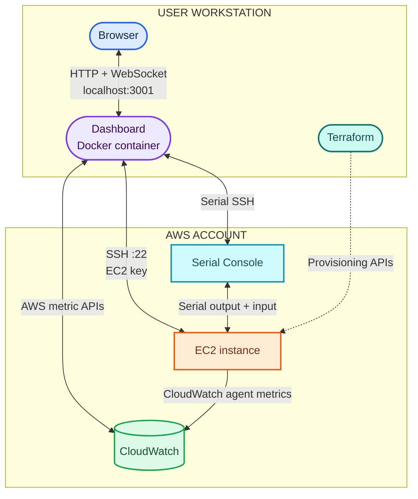
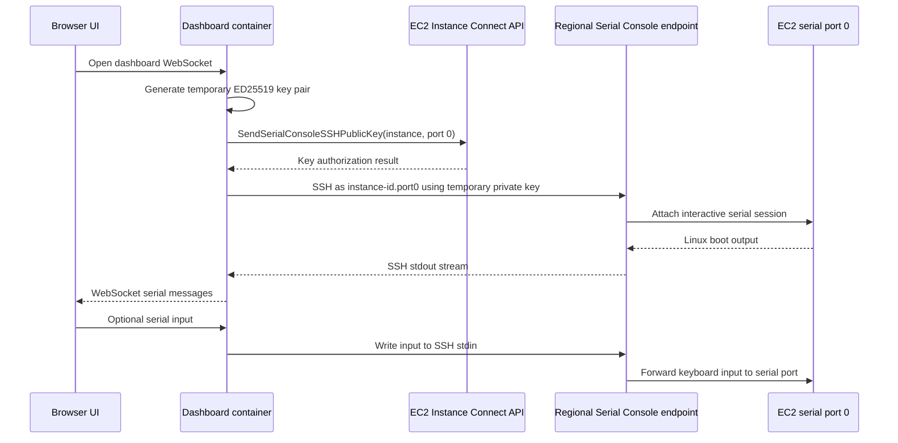
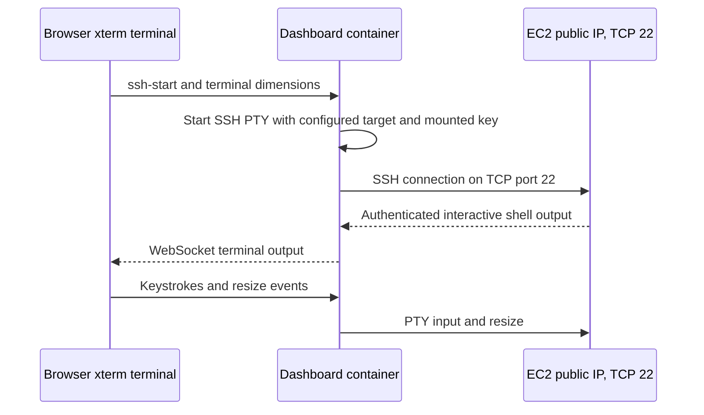
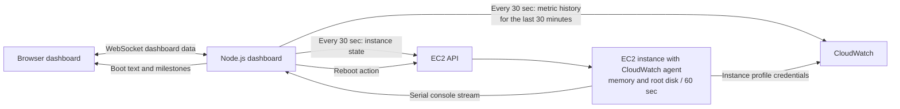

# EC2 Serial Console Dashboard

A browser dashboard for an EC2 instance. It displays the serial console stream and boot milestones, CloudWatch metrics, instance status, a reboot action, and an interactive SSH terminal.

The dashboard is distributed as a Docker image and configured at runtime for the EC2 instance created by Terraform:

```text
sotirusama/aiot-ec2-serial-console-dashboard:latest
```

The image contains the Node.js application only. It does not contain AWS credentials, Terraform state, an EC2 private key, or the generated instance configuration. These are provided from each user's workstation at runtime.

## Architecture review

The project has two deployment layers. Terraform provisions the target and its AWS-side permissions. The dashboard is a separate Node.js application, distributed as a Docker image and run from a workstation. At runtime, the container connects to the instance through two independent paths: the AWS EC2 Serial Console for boot output and a normal SSH session for an interactive shell.

### Components and boundaries

| Component | Responsibility | Credentials or access it uses |
| --- | --- | --- |
| Terraform in the user's checkout | Creates the VPC and networking, EC2 instance, security group, instance profile, dashboard IAM policy, and regional Serial Console setting. | The selected AWS CLI profile, with permission to manage the resources and pass the EC2 role. |
| `dashboard.env` | Carries the Terraform outputs needed to target the current instance: region, profile, instance ID, serial port, SSH destination, and key path. | Contains configuration, not AWS profile credentials or private key material. Regenerate it after the instance is replaced. |
| Dashboard container | Serves the web UI and brokers WebSocket traffic to AWS APIs, the serial console, CloudWatch, and the SSH process. | Reads the host AWS config and EC2 private key through read-only mounts. The image itself contains neither. |
| EC2 instance profile | Gives the instance's CloudWatch agent permission to publish metrics. | `CloudWatchAgentServerPolicy`, attached by Terraform. |
| Browser | Displays serial output, boot milestones, metrics and instance status; sends serial input, reboot requests, and browser-terminal keystrokes. | Connects to the locally published dashboard port. It does not receive AWS credentials or the SSH private key. |

The diagrams show the current implementation and its two separate SSH-related flows. The dashboard's serial-console connection uses a temporary key generated inside the container and registered through EC2 Instance Connect. The browser SSH terminal uses the user's EC2 key pair to connect directly to the instance's public IP.

### Deployment and runtime topology

This compact, color-coded view groups the workstation, dashboard, and AWS side; the detailed topology follows it.




Terraform state belongs to the workstation checkout that created the AWS resources. Each teammate should use a separate deployment and state file; sharing state can make users operate on or destroy the same resources unexpectedly.

### Serial Console boot-log flow

The browser does not connect to the EC2 serial port directly. The Node.js server creates an ephemeral ED25519 key pair, asks EC2 Instance Connect to authorize its public half for the configured instance and serial port, and starts SSH to the regional serial-console endpoint. The stream is then relayed through the dashboard's WebSocket connection.



The browser renders that stream as raw terminal output and uses observed boot text to update the boot sequence. The dashboard also sends the reboot action through the EC2 API; the resulting boot output arrives on the same serial stream. EC2 security-group ingress on port 22 is not the serial-console transport path.

### Browser SSH terminal flow

The separate **Open SSH Terminal** action starts an SSH process under a PTY in the container. It connects to `BROWSER_SSH_TARGET` (the Terraform-generated `ubuntu@public-ip`) over TCP port 22, authenticating with the mounted EC2 private key. xterm in the browser handles terminal rendering and sends keystrokes and resize events back over WebSocket.



This path requires the EC2 security group to allow SSH from the user's source address. The current Terraform security group allows ports 22 and 80 from `0.0.0.0/0`; restrict SSH to a trusted `/32` before applying in an account you care about. Port 80 is not used to serve this dashboard. Docker publishes the dashboard on the workstation's loopback address, `127.0.0.1:3001`.

### Monitoring and refresh behavior

The Node.js process polls instance state and CloudWatch data every 30 seconds while a browser is connected. Each response includes up to 30 minutes of metric history for the graphs. The EC2 CloudWatch agent is configured to publish memory and root-disk metrics every 60 seconds. EC2 CPU and network metrics use the AWS monitoring period: normally 300 seconds for basic monitoring, or 60 seconds if detailed monitoring is enabled. A 30-second dashboard refresh can therefore show the same latest metric more than once while waiting for CloudWatch's next datapoint.



Terraform's dashboard policy currently covers EC2 instance/status actions and serial-console key registration. The dashboard also calls CloudWatch `ListMetrics` and `GetMetricData`; the reproduction steps below show the additional read-only policy those calls require when the selected profile does not already have it.

### Operational notes

- The Docker image is an application artifact, not a complete deployment bundle. AWS credentials, the Terraform state, and the EC2 private key stay outside the image and are supplied locally at runtime.
- `dashboard.env` is generated per deployment and should be refreshed after Terraform replaces the instance or changes its address.
- The current AMI ID, EC2 key-pair name, and permissive security-group rules are repository configuration. Review them for your region and account before applying.
- The published `latest` Docker tag is mutable. Pin a specific image tag or digest when repeatable image versions are important.

## Requirements

- Git
- Docker Engine or Docker Desktop
- Terraform
- AWS CLI v2
- An AWS account where your identity can create the resources listed below
- An EC2 key pair in the selected region and its matching private key file
- An SSH `known_hosts` file on the workstation for the regional EC2 Serial Console endpoint

Terraform manages a VPC, subnets, route tables, an internet gateway, security group, EC2 instance, IAM role and instance profile, IAM policy, and EC2 Serial Console access setting. The identity used for `terraform apply` needs permissions to manage those resources, including IAM roles, policy attachments, and `iam:PassRole` for the instance profile. Use an account or role approved by your organization; do not use root-user credentials.

The dashboard's AWS profile needs permission to describe the configured instance and status, read its CloudWatch metrics, reboot it, and register an EC2 Serial Console public key. Terraform creates a policy for these dashboard actions. You can ask Terraform to attach it to the IAM user or role used by the profile, or attach the policy yourself if your organization manages IAM separately.

## Reproduction guide

Follow these steps from a workstation with access to your own AWS account. The guide starts by checking the AWS identity, then creates the infrastructure, and finally runs the published image. Each teammate should make a separate AWS deployment and keep its Terraform state in their own checkout. Do not share Terraform state files between accounts or users.

## 1. Clone this repository

```bash
git clone https://github.com/SotirUsama1/NU-ECEN430-AIoT_Task.git
cd NU-ECEN430-AIoT_Task
```

## 2. Configure your AWS profile

Choose a profile name for this deployment. This example uses `dashboard-dev`; you can use a different name. Configure credentials using your organization's process:

```bash
aws configure --profile dashboard-dev
```

For an AWS IAM Identity Center / SSO profile, use your organization's SSO configuration and authenticate before applying:

```bash
aws sso login --profile dashboard-dev
```

Confirm that the profile points to the intended AWS account before creating anything:

```bash
aws sts get-caller-identity --profile dashboard-dev
```

The account ID and ARN returned here should be the account and identity where you intend to create the resources. Terraform and the dashboard container will both use this profile. The AWS config directory is mounted into Docker so the container can resolve the same profile. For SSO or role-based profiles, the profile configuration and any required cached SSO credentials must also be available in that directory.

## 3. Prepare an EC2 key pair

The current Terraform configuration uses an EC2 key pair named `DEPI-test-key-paris` in `terraform/main.tf`. For a new AWS account, create a key pair with that name in the selected region, or change the `key_name` in `terraform/main.tf` to your own key-pair name.

If the key pair does not already exist, you can create it with the AWS CLI. This writes the private key material to a local file; protect that file and do not commit it:

```bash
mkdir -p "$HOME/.ssh"
aws ec2 create-key-pair \
  --profile dashboard-dev \
  --region eu-west-3 \
  --key-name DEPI-test-key-paris \
  --query KeyMaterial \
  --output text > "$HOME/.ssh/DEPI-test-key-paris.pem"
chmod 400 "$HOME/.ssh/DEPI-test-key-paris.pem"
```

The private key must match the key pair named in Terraform. The dashboard mounts it into the container read-only; it is never copied into the Docker image. If you choose a different key path, use that same path in both `terraform/terraform.tfvars` and the Docker run command below.

## 4. Configure Terraform for this account

Create `terraform/terraform.tfvars`. This file is ignored by Git and must remain local. Set `aws_profile` to the profile you just checked, and set the key path for your workstation.

```hcl
aws_region = "eu-west-3"
aws_profile = "dashboard-dev"
dashboard_ssh_key_path = "/home/YOUR_USER/.ssh/DEPI-test-key-paris.pem"

# Optional: have Terraform attach its generated dashboard policy to the
# IAM identity used by aws_profile. Use the IAM user or role name, not its ARN.
dashboard_iam_identity = {
  type = "user" # choose "role" when the profile uses an IAM role
  name = "YOUR_IAM_USER_NAME"
}
```

If your profile assumes an IAM role, set `type = "role"` and `name` to that IAM role's name. The credentials used to run Terraform must be allowed to attach the policy. If you omit `dashboard_iam_identity`, the profile's IAM identity must already have the dashboard permissions listed above.

The policy created by this Terraform currently grants the dashboard's EC2 actions. The dashboard also calls CloudWatch `ListMetrics` and `GetMetricData` for its graphs. Attach these read actions to the dashboard IAM user or role if it does not already have equivalent permission:

```json
{
  "Version": "2012-10-17",
  "Statement": [
    {
      "Effect": "Allow",
      "Action": ["cloudwatch:ListMetrics", "cloudwatch:GetMetricData"],
      "Resource": "*"
    }
  ]
}
```

The repository currently defaults to region `eu-west-3` and hard-codes a region-specific AMI ID and the key-pair name in `terraform/main.tf`. A different AWS account can use the same public AMI in `eu-west-3`, but if you choose another region, update the AMI ID and key-pair name to valid values in that region before applying.

## 5. Review and create the AWS resources

Initialize Terraform, inspect the plan, and apply it only after confirming that the account, region, and resources are correct:

```bash
terraform -chdir=terraform init
terraform -chdir=terraform plan
terraform -chdir=terraform apply
```

Terraform state is stored locally under `terraform/terraform.tfstate` and is ignored by Git. Keep this checkout and its state until you destroy the deployment. If you lose the state, Terraform may no longer be able to manage or clean up the resources it created.

The current security group in `terraform/main.tf` allows inbound SSH (port 22) and HTTP (port 80) from `0.0.0.0/0`. Before applying in an account you care about, restrict SSH to your public IP using a `/32` CIDR and remove the HTTP rule if you do not need it. The dashboard itself is not exposed on the EC2 instance's port 80; Docker publishes the dashboard on the workstation's localhost port 3001.

After apply, create the runtime environment file from Terraform outputs:

```bash
terraform -chdir=terraform output -raw dashboard_env > dashboard.env
```

This file contains the current region, profile name, instance ID, serial port, and SSH target. It does not contain the AWS profile credentials or SSH private key. Regenerate it after any Terraform apply that replaces the instance or changes its public IP.

Do not commit `terraform/terraform.tfvars`, `terraform/terraform.tfstate*`, `dashboard.env`, AWS credentials, SSO cache files, or private keys. Each teammate should use their own account credentials and local Terraform state.

## 6. Pull and run the published Docker image

Pull the image:

```bash
docker pull sotirusama/aiot-ec2-serial-console-dashboard:latest
```

The repository's `scripts/apply-dashboard.sh` is a source-build workflow: it builds an image from the checkout and runs Terraform apply. The commands in this section use the published Docker Hub image directly.

Before running the container, ensure the following files are readable on the workstation:

- The AWS config directory, normally `~/.aws`, containing the `dashboard-dev` profile and any credentials or SSO configuration it needs.
- The EC2 private key at the path configured in Terraform.
- `~/.ssh/known_hosts` containing the verified host key for the regional EC2 Serial Console endpoint. On the first connection, compare the displayed fingerprint with the region's AWS-published fingerprint before accepting it. See [AWS's EC2 Serial Console connection guide](https://docs.aws.amazon.com/AWSEC2/latest/UserGuide/connect-to-serial-console.html).

Set the two host paths in your shell. If you used a custom AWS config directory, set `AWS_CONFIG_DIR` first. If you chose a different key file, update `SSH_KEY_PATH` to match `dashboard_ssh_key_path`.

```bash
AWS_FILES_DIR="${AWS_CONFIG_DIR:-$HOME/.aws}"
SSH_KEY_PATH="$HOME/.ssh/DEPI-test-key-paris.pem"

mkdir -p .dashboard-ssh
chmod 700 .dashboard-ssh

docker run --rm --init \
  --name ec2-serial-console-dashboard \
  --user "$(id -u):$(id -g)" \
  --publish 127.0.0.1:3001:3001 \
  --env-file dashboard.env \
  --env BROWSER_SSH_KEY_PATH=/run/secrets/dashboard-ssh-key \
  --mount "type=bind,src=$AWS_FILES_DIR,dst=/home/node/.aws,readonly" \
  --mount "type=bind,src=$HOME/.ssh/known_hosts,dst=/home/node/.ssh/known_hosts,readonly" \
  --mount "type=bind,src=$SSH_KEY_PATH,dst=/run/secrets/dashboard-ssh-key,readonly" \
  --mount "type=bind,src=$PWD/.dashboard-ssh,dst=/run/dashboard-ssh" \
  sotirusama/aiot-ec2-serial-console-dashboard:latest
```

The container runs in the foreground. Open [http://localhost:3001](http://localhost:3001) and press **Ctrl+C** in the terminal to stop it. The port binding only exposes the dashboard to the local machine. Do not change it to `0.0.0.0` unless you have deliberately configured appropriate network access controls.

If you use AWS SSO and the session expires, authenticate again with `aws sso login --profile dashboard-dev`, then restart the container.

## 7. Recreate the instance later

To destroy and recreate the infrastructure, use the same checkout and Terraform state. After applying again, regenerate `dashboard.env` and restart the container. The instance ID and public IP are read from Terraform outputs, so the dashboard follows the newly created instance.

## 8. Clean up

Stop the dashboard container with **Ctrl+C**, then destroy the AWS resources from the same checkout that owns the state:

```bash
terraform -chdir=terraform destroy
```

Review the destroy plan and confirm it targets only this deployment. AWS may bill for resources while they exist, including EC2 and public IPv4 usage. Terraform destroy does not delete the local Docker image or your EC2 key pair.

## Troubleshooting

### Terraform says the AWS profile cannot be found or authenticated

Check the profile name in `terraform/terraform.tfvars`, then confirm it with:

```bash
aws sts get-caller-identity --profile dashboard-dev
```

The `aws_profile` value must match the profile name in this command. If it uses SSO, run `aws sso login --profile dashboard-dev` again.

### The dashboard reports missing AWS credentials

Confirm `AWS_FILES_DIR` points to the host directory containing the profile, and that this directory is mounted at `/home/node/.aws`. The container uses the `AWS_PROFILE` value generated in `dashboard.env`.

### Browser SSH reports that the private key is missing or unreadable

Confirm `SSH_KEY_PATH` points to the private key on the host, that it matches the key pair configured in Terraform, and that the file is readable. The Docker command mounts it at `/run/secrets/dashboard-ssh-key` and overrides `BROWSER_SSH_KEY_PATH` to that container path.

### Serial Console authorization fails

Confirm that the dashboard profile has the generated dashboard policy (or equivalent permissions), the regional Serial Console setting is enabled, the instance is running, and no other Serial Console session is active. Terraform enables the regional setting when the account permits it.

### The dashboard does not load

Check that the container is running and that port 3001 is not already in use. The Docker command binds to `127.0.0.1:3001`; open `http://localhost:3001` on the same computer running Docker.

### CloudWatch graphs are empty

The instance installs the CloudWatch agent during first boot and collects memory and root-disk metrics every 60 seconds. Allow time for installation, agent startup, and metric publication. Confirm the EC2 instance role includes `CloudWatchAgentServerPolicy` and that the instance can reach AWS CloudWatch endpoints.

## Repository and image

- GitHub source: [SotirUsama1/NU-ECEN430-AIoT_Task](https://github.com/SotirUsama1/NU-ECEN430-AIoT_Task)
- Docker Hub image: [sotirusama/aiot-ec2-serial-console-dashboard](https://hub.docker.com/r/sotirusama/aiot-ec2-serial-console-dashboard)
- The `latest` tag is mutable. Pull it again to get the version most recently published by the image owner.
